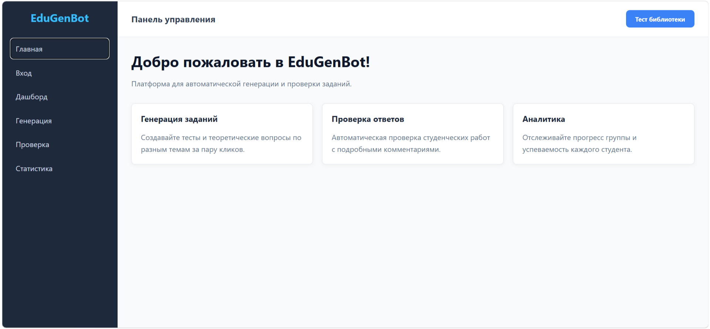
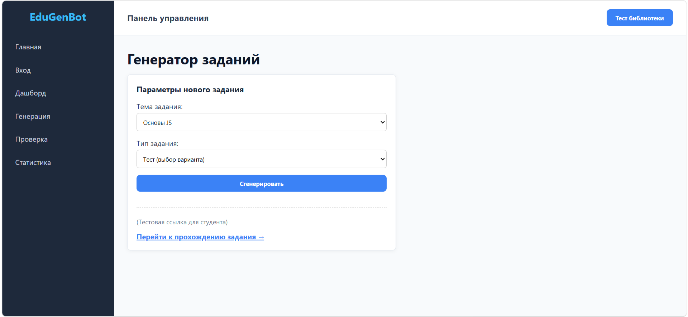
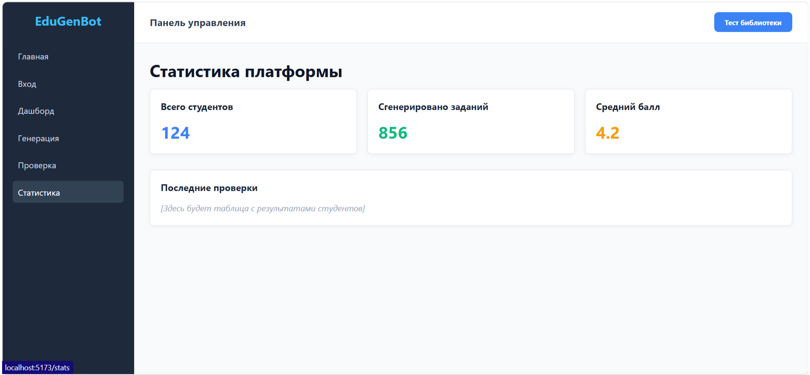
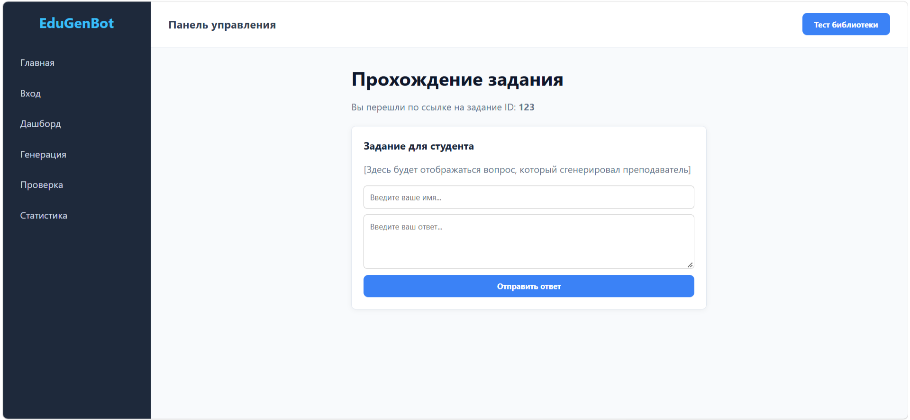

# EduGen Platform

Курсовой проект: Образовательная платформа с генерацией заданий и автоматической проверкой для преподавателя (с перспективой интеграции с Node.js).

## Описание проекта
Данный репозиторий содержит каркас клиентской части приложения (Skeleton), реализованный в рамках Лабораторной работы №5. Проект разделен на два пакета:
1. `ui-library` — библиотека переиспользуемых UI-компонентов (React + TypeScript).
2. `frontend` — основное приложение-витрина с настроенным роутингом.

## Скриншоты работы приложения

### Главная страница


### Страница генерации заданий


### Страница статистики


### Страница прохождения задания (для студента)


## Инструкция по запуску

Для запуска вам понадобятся **Node.js** и **npm**. Все команды выполняются в терминале **PowerShell**.

### Шаг 1: Сборка библиотеки компонентов
```powershell
cd ui-library
npm install
npm run build
